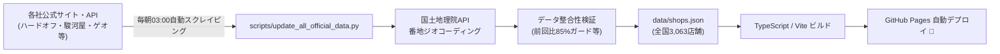

# ホビめぐ（Hobimegu） - 全国中古＆ホビーショップ巡りマップ 🗺️✨

[](https://github.com/Katsu2013/Secondhand-Hobby-Shops-Map/actions/workflows/update-shops.yml)
[](tests/)
[](tests/)
[](tsconfig.json)
[](LICENSE)

> **探す手間ゼロ。現在地や指定駅から「今から行ける」ホビー・中古ショップを即座に一覧・ルート案内。**
> ハードオフ、ホビーオフ、駿河屋、アニメイト、ゲオ、イエローサブマリン、ポポンデッタ、手芸店など、全国 **3,063 店舗** の最新情報を網羅した巡回マップウェブアプリです。

---

## 🌟 主な特徴・機能

### 1. 全国 3,063 店舗・23チェーン・6ジャンル体系
各チェーンの公式サイトや一次情報APIからスクレイピングし、国土地理院APIにより番地レベルで正確にジオコーディングされた高品質なデータベースを内蔵しています。
オプション画面ではジャンル別の小見出しにより、目的のジャンルを直感的に絞り込めます。

| ジャンル分類 | 収録チェーン |
| :--- | :--- |
| **💻 PC・スマホ・デジタル系** | イオシス、じゃんぱら、パソコン工房 / グッドウィル、ショップインバース |
| **🏠 総合リユース・ハードオフ系** | ハードオフ、ホビーオフ、オフハウス、ブックオフ（SUPER BAZAAR / PLUS含） |
| **🎮 ゲーム・エンタメ・大型リユース系** | ゲオ（GEO）、古本市場・ふるいち、お宝創庫、万代、マンガ倉庫 |
| **✨ アニメ・キャラクター・同人系** | 駿河屋、アニメイト、らしんばん、メロンブックス、まんだらけ |
| **🎲 ホビー・模型・カード専門店系** | イエローサブマリン、ポポンデッタ、お宝あっとマーケット、鑑定団グループ |
| **🧵 手芸・ハンドメイド・クラフト系** | ユザワヤ、クラフトハートトーカイ、オカダヤ、パンドラハウス |

### 2. ハードオフ公式アプリ風「縦積みブランド看板バルーン」
ハードオフ＋ホビーオフ＋オフハウスのような大型複合店では、公式アプリのように各ブランドの看板プレートを縦に積み重ねて表示します。
オプション設定で特定のチェーン（例: オフハウス）をOFFにすると、そのブランドの看板プレートだけがリアルタイムに除外されます。

### 3. APIキー不要のハイブリッド地図エンジン
- **内蔵マップ（OpenStreetMap + Leaflet）**: APIキーを入力することなく、初回アクセス時から即座に全国の店舗表示・検索・所要時間確認・ルート案内が使えます。
- **Google Maps モード**: お手持ちの Google Maps API キーを入力することで、ストリートビュー、航空写真、およびリアルタイム渋滞予測を考慮したルート検索へいつでもアップグレード可能です。

### 4. 6つの移動手段 ＆ ハイブリッド所要時間計算
- **対応移動モード**:
  - 🚗💨 車（有料道路優先）
  - 🚗 車（一般道優先）
  - 🚃 電車・バス（公共交通）
  - 🚲 自転車
  - 🚶 徒歩
- **2段階速度モデル（市街地＋幹線・高速）**: 地図画面内の全店舗に対して、直線距離×迂回係数と速度モデルによるリアルタイム概算時間を常時表示（待ち時間ゼロ）。
- 店舗をクリックした際は、Google Directions API または OSRM（Open Source Routing Machine）による実道路ルート検索へ即座に更新されます。

### 5. リアルタイム「閉店に間に合うか」到着判定
店舗ごとに大きく異なる営業時間（20:00閉店、22:00閉店、深夜営業、24時間営業など）を自動解析。
出発時刻（現在時刻または指定時刻）と移動所要時間から、到着時に店舗が開いているかを判定して色分け表示します：
- 🟢 **間に合う**: 閉店まで30分以上の十分な買い物時間がある状態
- 🟠 **ギリギリ**: 閉店前には着けるが、残り30分未満の状態
- 🔴 **間に合わない**: 到着予定時刻にはすでに閉店している状態（「間に合わない店舗を非表示」フィルタ連動）
- 🔵 **開店前着**: 朝の出発などで開店前に到着する状態

### 6. 最適巡回（ハシゴ）ルート検索
休日に複数店舗を巡りたい時、気になる店舗を「+巡回ハシゴ」ボタンでリストに追加するだけで、最近傍法（Nearest Neighbor）により最も効率的な立ち寄り順序へ自動整列。複数店舗を巡る最適ルートと合計所要時間を一度に計算します。

---

## 🛠️ 自動更新パイプライン（GitHub Actions）

本リポジトリは、**毎日午前 03:00 JST (18:00 UTC)** に GitHub Actions が自動起動し、最新の店舗データを巡回・更新しています：



- **安全ガード機能**: 相手先サイトの障害やメンテナンス時にデータが破損（0件など）しないよう、最小期待件数チェックおよび前回比85%未満の異常検知時は自動的に既存データを維持します。
- **手動実行**: GitHub の [Actions タブ](https://github.com/Katsu2013/Secondhand-Hobby-Shops-Map/actions) から `workflow_dispatch` によりいつでも手動で最新化を実行できます。

---

## 💻 開発環境・コマンド一覧

### 必要要件
- **Node.js**: v20.x または v22.x 以上
- **Python**: 3.10 以上（3.12 推奨、データ更新スクリプト実行時）

### セットアップ
```bash
# リポジトリのクローン
git clone https://github.com/Katsu2013/Secondhand-Hobby-Shops-Map.git
cd Secondhand-Hobby-Shops-Map

# 依存パッケージのインストール
npm install
```

### コマンド一覧
| コマンド | 説明 |
| :--- | :--- |
| `npm run dev` | 開発サーバーを起動（`http://localhost:8080/`） |
| `npm run build` | TypeScript型チェック（`tsc -b`）およびVite本番バンドル |
| `npm test` | Node.js ユニットテスト実行（全25件） |
| `npm run test:data` | Python データパイプラインテスト実行（全24件） |
| `npm run docs` | TypeDoc による API 仕様書HTML自動生成（`docs/typedoc/` 配下） |
| `npm run update-data` | 全チェーンの公式サイトから最新店舗データを取得しマスターDBを再構築 |
| `npm run preview` | 本番ビルド成果物（`dist/`）をローカルでプレビュー確認 |

---

## 📁 ディレクトリ構成

```text
├── .github/workflows/          # GitHub Actions ワークフロー定義
│   ├── update-shops.yml        # 毎日午前3時実行の店舗自動更新＆デプロイ
│   └── deploy.yml              # mainブランチ更新時の自動デプロイ
├── data/                       # 配布用店舗マスターデータベース
│   └── shops.json              # 全国3,063店舗の検証済みJSON
├── docs/                       # ドキュメントディレクトリ
│   └── typedoc/                # TypeDoc により自動生成されたAPI仕様書
├── public/                     # Vite 公開静的ファイル
│   ├── favicon.svg             # アプリ公式ロボットピンアイコン
│   └── data/shops.json         # アプリ実行時に参照される店舗データ
├── scripts/                    # Python データ収集・ビルドスクリプト群
│   ├── update_all_official_data.py # 全チェーン自動更新バッチ本体
│   ├── geocode_and_build.py    # 国土地理院ジオコーディング＆統合ビルド
│   ├── gsi_geocode_cache.json  # ジオコーディングAPIのローカル永続キャッシュ
│   └── official_*.json         # 各チェーンの公式店舗データスナップショット
├── src/                        # React + TypeScript ソースコード
│   ├── components/             # UIコンポーネント群
│   │   ├── HeaderBar.tsx       # 上部ヘッダー（移動手段・主要エリアジャンプ）
│   │   ├── MapCanvas.tsx       # 地図描画キャンバス（Leaflet / Google Maps）
│   │   ├── OptionsPanel.tsx    # オプション設定パネル（チェーン/カテゴリ絞り込み）
│   │   ├── ShopListPanel.tsx   # 画面内店舗一覧リスト＆巡回ハシゴバー
│   │   └── Modals.tsx          # Google Maps APIキー設定モーダル
│   ├── config/                 # マスターデータ定義
│   │   └── shopMaster.ts       # チェーン定義、看板仕様、移動推計、閉店判定
│   ├── services/               # サービス層
│   │   ├── mapService.ts       # ジオコーディング、OSRM、探索サービス
│   │   ├── routeService.ts     # ルート検索・交通予測取得サービス
│   │   ├── shopValidation.ts   # 店舗データの実行時整合性バリデーション
│   │   └── storageService.ts   # localStorage 永続化サービス
│   ├── types/                  # 型定義
│   │   ├── shop.ts             # アプリケーション共通インターフェース・型
│   │   └── googleMapsGlobal.d.ts # Google Maps 動的ロード用アンビエント型宣言
│   ├── App.tsx                 # ルートコンポーネント（状態統合管理）
│   └── main.tsx                # アプリケーションエントリーポイント
└── tests/                      # 自動テストスイート
    ├── *.test.cjs              # Node.js テストファイル（全25件）
    └── test_*.py               # Python テストファイル（全24件）
```

---

## 🔒 プライバシーとセキュリティ

- **位置情報（GPS）**: ユーザーの明示的な許可があった場合のみブラウザ内で利用され、外部サーバーへ送信・保存されることはありません。
- **Google Maps API キー**: 入力されたAPIキーはユーザー自身のブラウザ（`localStorage`）内のみに保持され、第三者のサーバーへ保存されることはありません。
- **XSS対策**: 店舗名や営業時間の表示には厳格なエスケープ処理を実施し、安全性を確保しています。

---

## 📜 ライセンス

本プロジェクトは [MIT License](LICENSE) のもとで公開されています。
各店舗チェーンの名称・ブランド看板・ロゴ等の商標権および知的財産権は各企業に帰属します。
本アプリは各社公式サイトで一般公開されている一次情報に基づいており、各店舗の実在庫やリアルタイムの営業を保証するものではありません。
