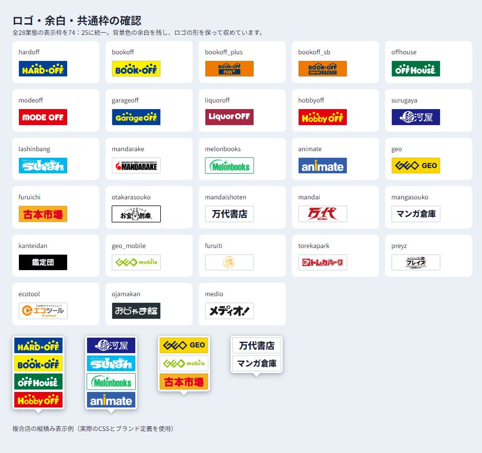
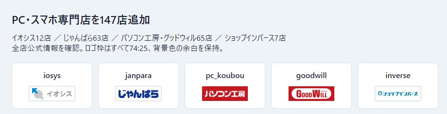
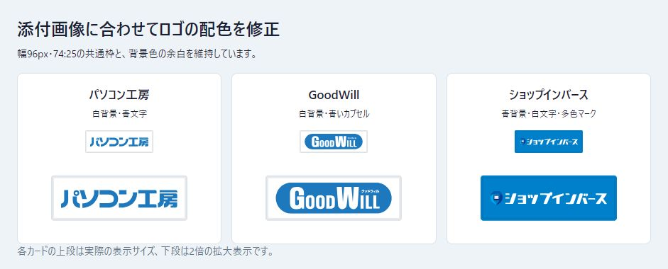

# ロゴ表示の調整（2026-10-19）

PC専門店の追加を反映し、表示枠は全33業態で共通の横74：縦25。幅96px、高さ約32.43px。ロゴ画像の比率は保ち、枠内へ収める。正方形ロゴや2段のBOOKOFF PLUS・SUPER BAZAARでも看板の枠サイズは変えない。

プレート内の背景色の余白は上下3px・左右6px。白い吹き出しの外余白と看板間隔は3pxとし、添付の地図画像のように余白を残す。メロンブックスの元画像440pxのうち、右側の空白172pxを除いた268pxを表示用の範囲とした。

## 原本と表示用SVG

- 指定のハードオフ業態パネルから、系列6業態と通常BOOKOFFの輪郭を取得。通常BOOKOFFは黄地に青文字・青い中点。
- BOOKOFF SUPER BAZAAR・PLUSはそれぞれ指定された画像の構成とオレンジ色を採用。
- 駿河屋は公式SVGの日本語パスを利用し、独立したJPパスを除去。青地に白文字。
- アニメイトは公式SVGの文字パスを白に、i全体を黄色に指定。
- メロンブックス・らしんばん・古本市場は文字の色・輪郭を抽出してSVGの曲線パスに変換。
- まんだらけ・ゲオモバイル・ふるいち・トレカパークも表示用SVGを生成。通常ゲオとゲオモバイルは区別する。
- 通常GEOは公式画像の系列共通マークを輪郭パス化。高解像度のゲオモバイル原本からマークだけを取得し、通常ゲオの原本とも形状を照合した。濃紺のマーク＋GEO文字を黄色のプレートに表示する。
- イオシスは公式SVGのマークと店名を残し、独立した「けっこう安い。」の広告文を除外する。パソコン工房・グッドウィルは同じ公式SVGからそれぞれの業態部分を表示。じゃんぱら・ショップインバースは公式PNGの外周余白を除いて輪郭をSVGパス化。5看板とも共通枠・余白を維持する。
- その他は取得済みの公式SVGを使用。一律の画像を特定できない万代書店・マンガ倉庫・鑑定団は名称を通常文字で表示。万代書店は18px、マンガ倉庫は16pxの太字にし、共通枠内の余白を詰める。

表示画像はすべてSVGのパス・図形を使い、ラスター画像の埋め込みは含まない。曲線化は輪郭の近似であり公式ベクターデータではない。指定された参照画像と画面表示を目視で照合する。原本は無加工で残し、出典・確認日・SHA-256、表示用ファイル・SHA-256・変換内容を`public/brands/sources.json`で管理する。

## 手動更新

リポジトリのルートで実行する。専用の依存は実行環境にだけ入れる。

```powershell
python -m pip install -r scripts/requirements-brand-assets.txt
# 原本の更新と表示用SVGの生成
python scripts/update_brand_assets.py
# 原本を再取得せず表示用SVGだけ生成
python scripts/build_brand_displays.py
# PC専門店5看板も生成する
python scripts/build_pc_brand_displays.py
```

`pinned: true`のブランドは、指定されたURLと原本ファイル名を保持する。表示範囲を変える場合は`viewport`または生成スクリプト内の範囲を調整する。駿河屋の原本のパス構造が変わった場合は自動生成を止め、JPの位置を再確認する。

`update_brand_assets.py`は上記2つの表示用生成処理を呼び出す。元画像を再取得せずに全業態を生成する場合は、両方のbuildコマンドを実行する。PC用生成処理も同じPillow・vtracerを使用する。

通常のGitHub Actionsによる店舗データ更新はロゴ画像を変更せず、Pillow・vtracerも使用しない。

## 確認結果

PC専門店追加前の確認では、ブラウザーで従来28業態すべての枠が幅96px・高さ32.421875px（ブラウザーの丸め値）で揃い、画像読込失敗がないことを確認。元画像に比べて文字の欠けがないこと、配色・余白・複合店の縦積み表示を目視確認した。




PC専門店追加後は33業態。追加5看板も幅96px・高さ32.421875px、74:25の共通枠で読み込めることを確認した。原本と表示用SVGのハッシュが一致し、ラスター埋込がないことも確認済み。

店舗追加直後（配色修正前）の記録：




## 添付看板に合わせた配色修正

パソコン工房・GoodWillは白背景に青#1d78beを使用。工房の文字は青、GoodWillは青いカプセルに白い文字とし、公式SVGの輪郭を維持する。青は添付JPEGの代表色であり、ブランド公式の厳密な指定色と断定しない。

ショップインバースは背景#0080cb・白文字へ変更。公式原本のピンマークは青の濃淡と白いPC画面を保持し、文字と一緒に単色化しない。高田馬場などの支店名部分は共通のロゴに含めない。参照添付画像はpublic/brands/references/へ原本のまま保存し、sources.jsonのdisplayColorReferenceに出所・ハッシュ・適用色を記録する。手動再生成でもこの配色を維持する。

幅96px・横74:縦25、上下3px・左右6pxの余白は継続する。


